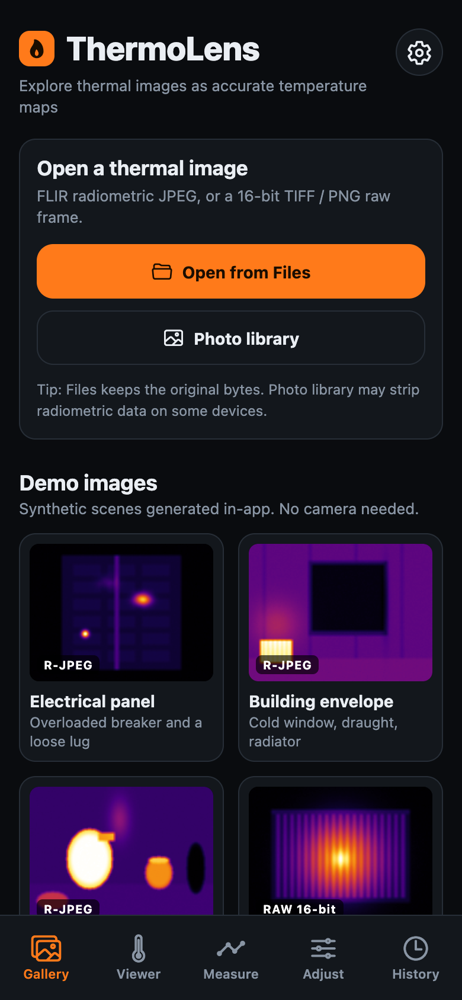
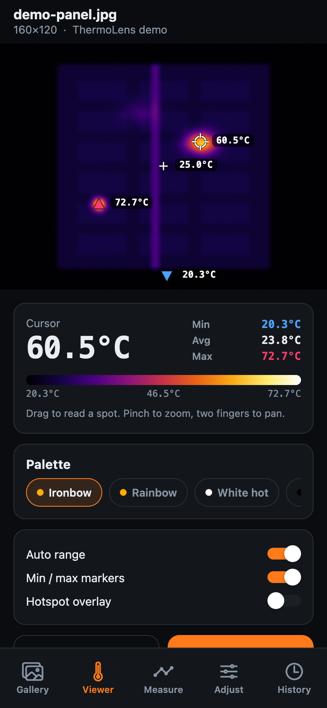
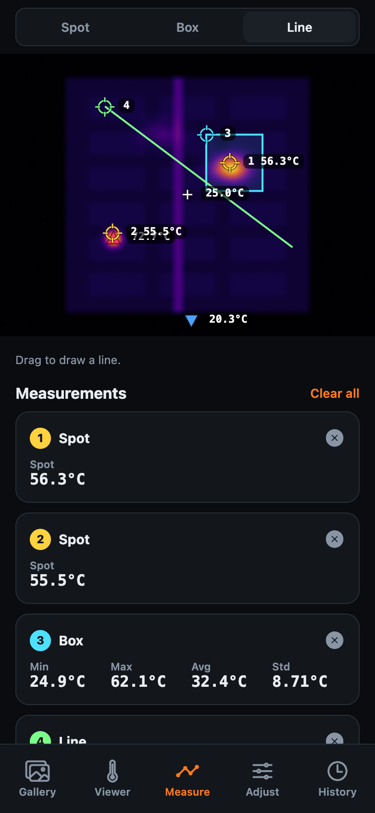
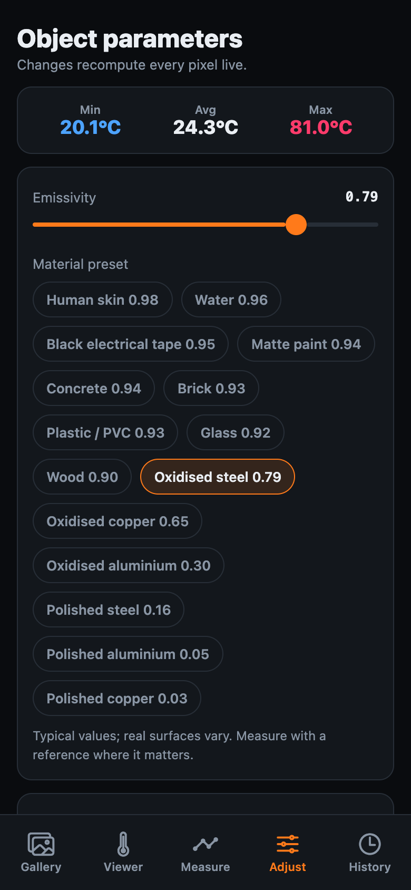
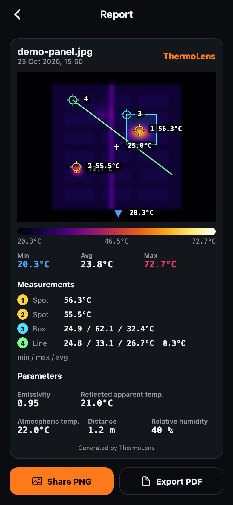

<div align="center">

# ThermoLens

**Open thermal images and explore them as accurate temperature maps.**








</div>

The screenshots are real captures of the web build (`npx expo export --platform web`) driven with Playwright at a phone-sized viewport.

## Features

- **Open thermal files**: FLIR radiometric JPEG (R-JPEG) is the primary format. 16-bit TIFF and PNG raw frames are supported with a user-chosen calibration (0.01, 0.04 or 0.1 K per count, T-linear).
- **Viewer**: drag a crosshair to read the temperature under it, pinch to zoom, min/max markers, selectable palettes (ironbow, rainbow, white hot, black hot, arctic), auto or manual range, and a hotspot overlay above a chosen threshold.
- **Measure**: spot, box (min / max / avg) and line profile (with chart) tools.
- **Adjust**: per-image emissivity, reflected apparent temperature, atmospheric temperature, distance and relative humidity. The temperature map is recomputed from the raw data, so changes are physically meaningful, not a re-tint. A material table gives common emissivity values.
- **History**: save an analysis (raw data, parameters and measurements) to local SQLite and reopen it later.
- **Report**: a shareable card with the image, palette bar, statistics, measurements and parameters, exported as PNG or PDF.
- **Settings**: Celsius / Fahrenheit, English (default) / Turkish, haptics.
- **Demo images**: four synthetic scenes (electrical panel, building envelope, kitchen, heatsink) generated in-app, so no camera is needed. The three R-JPEG demos go through the real parser.

Not included: live camera streaming (see roadmap).

## How the radiometry works

FLIR R-JPEGs store the sensor's raw counts plus calibration constants (R1, R2, B, F, O). The pipeline in `src/core/` is pure TypeScript:

1. **Parse**: find the `FLIR\0` APP1 segments, reassemble the chunks, read the FFF record directory, then decode the raw frame (PNG or uncompressed 16-bit) and the camera-info record.
2. **Correct the signal** for emissivity ε, reflected radiation, atmosphere and window:

   `S_obj = raw / (ε · τ · …) − (reflected and atmosphere terms)`

   with the atmospheric transmission computed from distance, humidity and temperature using the two-term FLIR model and a water-vapour estimate `H2O = (RH/100) · exp(1.5587 + 0.06939·T − 0.00027816·T² + 0.00000068455·T³)`.
3. **Convert to temperature** with the Planck-type calibration:

   `T = B / ln( R1 / (R2 · (S + O)) + F ) − 273.15`

   and its inverse `S(T) = R1 / (R2 · (exp(B/T) − F)) − O`.

For T-linear raw frames, the apparent temperature is `raw · K_per_count + offset`, then corrected with Planck band radiance integrated over 7.5 to 14 µm.

`src/core/planck.ts` also provides spectral radiance, band integration, Wien's peak and the Stefan-Boltzmann law. Tests check Wien's peak at 300 K (about 9.66 µm) and that the band integral over a wide range matches σT⁴/π.

**Rendering.** The temperature map is colorized in JS through a 256-entry palette LUT and encoded as a PNG data URI (fflate for deflate), then shown with a plain `Image`. This runs identically on iOS, Android and web with no native module, and cursor, markers and overlays are drawn as separate layers so only the image is regenerated when the palette or range changes (deferred, so slider drags stay smooth). Images of this class are small (the demos are 160x120), which keeps this cheap; I did not benchmark larger frames.

## Accuracy and limits

- The FFF layout and the CameraInfo offsets follow community documentation. They are **not verified against real camera files**: no permissively licensed R-JPEG was available, so the test and demo files are **synthetic**, built by `src/core/synth.ts` with the same layout the parser reads. Round-trip tests pass within 0.1 °C, which proves internal consistency, not agreement with a real camera.
- Byte order is inferred from the header version field, and 16-bit sample byte order is chosen by a smoothness heuristic.
- Photo-library import may strip radiometric data on some devices; use the Files picker.
- Not a calibrated measurement instrument.

## Architecture

```
src/
  core/    pure TS radiometry: planck, flir parser, png/tiff codecs, palettes,
           colorize, stats, measure, synthetic scenes and demos (no RN imports)
  store/   Zustand: settings (persisted) and session (frame, map, tool, measurements)
  data/    expo-sqlite persistence (localStorage on web)
  lib/     file picking, haptics, hooks, report rendering
  components/  ThermalCanvas, ProfileChart, PaletteBar, ReportCard, UI kit
  app/     Expo Router screens: (tabs) gallery, viewer, measure, adjust, history; report, settings
  i18n/    EN and TR dictionaries
__tests__/ Jest tests for the core (44)
```

## Getting started

```bash
npm install
npx expo start          # press i / a / w, or scan with Expo Go
```

```bash
npx tsc --noEmit        # typecheck
npm test                # jest
npx expo lint           # lint
npx expo export --platform web
```

CI (`.github/workflows/ci.yml`) runs typecheck, tests and lint.

## Roadmap

- Live streaming from FLIR ONE and InfiRay P2 (UVC) cameras
- AI hotspot detection
- On-device report sharing improvements
- Validation against real camera files

## License

MIT, see [LICENSE](LICENSE).

---

Made by **[Yusuf Erkan](https://www.linkedin.com/in/yusuferkan1/)**
